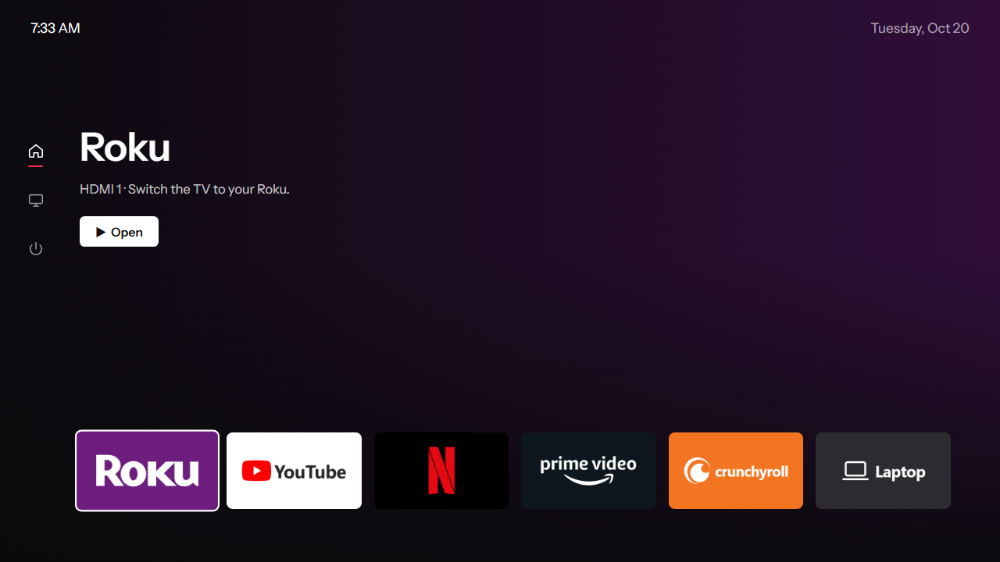
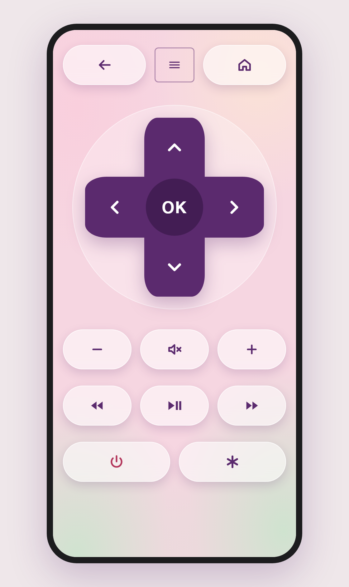

# tvui

A custom home screen and phone remote for Sony Bravia TVs.

tvui runs a small server on any always-on computer on your network, such as a
Raspberry Pi, a Jetson, or a spare laptop. It puts a clean home screen on the
TV, and your phone becomes the remote.

It needs Python 3.8+ and has no other dependencies.

<p align="center">
  <br>
  <em>The home screen on the TV</em>
</p>

<p align="center">
  <br>
  <em>The phone remote</em>
</p>

## What you need

- A Sony Bravia on your home network. tvui was tested on a 2014 KDL-70W850B,
  and should work on most network-enabled Bravias from 2013 on, including
  Android Bravias via a pre-shared key.
- A computer on the same network that stays on.
- A phone, for the remote.

## Install

```bash
pip install git+https://github.com/leonkoech/tvui.git
```

On Ubuntu 23.04+ or Debian 12+, use `pipx install git+https://github.com/leonkoech/tvui.git` instead.

## Set up

### 1. Prepare the TV

Turn the TV on, then on the TV:

- **Settings → Network**: connect to your Wi-Fi.
- **Settings → Network → Home Network Setup → Remote Device / Renderer**:
  turn on **Renderer** and **Remote Device Control**.
- Android Bravias only: **Settings → Network → IP control** → set
  **Authentication** to **Normal and Pre-Shared Key** and choose a key.

### 2. Pair

```bash
tvui setup
```

tvui finds the TV, and the TV shows a 4-digit PIN. Type it in. tvui then reads
your connected HDMI devices and streaming apps and builds the home screen from
them.

If tvui can't find the TV, pass its IP address with `tvui setup --tv 192.168.1.50`.
For an Android Bravia, add `--psk yourkey`.

### 3. Run it

```bash
tvui serve --open
```

The home screen opens on the TV.

### 4. Start on boot (Linux)

```bash
tvui install-service
```

This installs a systemd service, so tvui keeps running after reboots. To see
its logs, run `journalctl -u tvui -f`.

Give the computer running tvui a fixed IP address, so the phone remote's link
keeps working. You can do this with a DHCP reservation in your router, or on
the machine itself:

```bash
sudo nmcli con mod "<wifi name>" ipv4.method manual ipv4.addresses 192.168.1.20/24 \
  ipv4.gateway 192.168.1.1 ipv4.dns 192.168.1.1
sudo nmcli dev reapply <wifi device>
```

You don't need to do this for the TV. If its address changes, tvui finds it
again by itself.

## The phone remote

Run `tvui info` to get the remote's address, which looks like
`http://192.168.1.20:8765/remote`. Open it on your phone, then save it to your
home screen:

- **iPhone (Safari):** Share → **Add to Home Screen**
- **Android (Chrome):** ⋮ → **Add to Home screen**

It opens full screen with its own icon, like an app.

| Button | What it does |
|---|---|
| ← | Back |
| ≡ | The TV's own Sony menu |
| ⌂ | The tvui home screen |
| D-pad and OK | Move and select. Also works inside TV apps. |
| − / mute / + | Volume |
| ⏪ ⏯ ⏩ | Rewind, play/pause, fast forward |
| ⏻ | Power off |
| ✱ | Options |

The TV's own remote works on the home screen too. Use ← and → to move between
tiles. Press ← from the first tile to reach the side menu, which has the Sony
menu and power.

## Using the Roku remote

If you have a Roku, its remote can control the tvui home screen too. A small
relay app runs on the Roku and forwards your button presses to tvui, which
sends them to the TV.

1. Turn on Roku developer mode. On the Roku remote, press **Home ×3, Up ×2,
   Right, Left, Right, Left, Right**, choose **Enable installer and restart**,
   and set a password.
2. Install the relay:

   ```bash
   tvui roku-install --password <that password>
   sudo systemctl restart tvui   # or restart `tvui serve`
   ```

How it works:

- **On the home screen,** the Roku remote's arrows, OK, Back, play/pause,
  rewind, fast-forward and ✱ control the home screen.
- **After you open a Roku app** (a `roku` tile), the TV switches to the Roku
  and the remote works the Roku as usual.
- **The Roku's Home button** always goes to the Roku's own menu, because no
  app can intercept it. tvui notices and starts the relay again within a
  couple of seconds, so you stay in control of the home screen.
- If the TV jumps to the Roku's input whenever the relay starts, turn off
  **Settings → System → Control other devices (CEC) → 1-touch play** on the
  Roku.

The relay's source is in `src/tvui/roku/`.

## The home screen

When the TV turns on, tvui opens the home screen instead of the last input.
To turn this off, set `"home_on_power_on": false` in the config.

The tiles are saved in `~/.config/tvui/config.json`:

```json
"tiles": [
  { "name": "Roku",        "action": "input", "value": "extInput:hdmi?port=1", "label": "HDMI 1 · Switch to your Roku." },
  { "name": "YouTube",     "action": "app",   "value": "kamaji://BIV-3607" },
  { "name": "Netflix",     "action": "key",   "value": "Netflix" },
  { "name": "Crunchyroll", "action": "roku",  "value": "2595", "input": "extInput:hdmi?port=1" },
  { "name": "Laptop",      "action": "input", "value": "extInput:hdmi?port=2" }
]
```

There are four kinds of action:

- `input` switches to an HDMI input.
- `app` launches a TV app.
- `key` sends a remote key.
- `roku` switches to the Roku's HDMI input (`input`) and launches a Roku
  channel by its ID (`value`). This covers apps the TV doesn't have. tvui
  finds the Roku on the network by itself. To look up channel IDs, open
  `http://<roku-ip>:8060/query/apps`. That needs **Settings → System →
  Advanced system settings → Control by mobile apps → Network access** set to
  **Permissive**, but launching a channel works in the default mode.

`label` is optional, and sets the line shown under the title.

While the TV shows the Roku's input, the phone remote's D-pad, OK, back, menu,
options, and playback buttons control the Roku. Volume, mute, and power stay
with the TV. For this, set the Roku's **Network access** to **Permissive**, as
described above.

On older Bravias (around 2016 and earlier), the TV's own YouTube, Netflix, and
Prime apps may no longer work. YouTube, for example, shows "page is too large
to be displayed". If you have a Roku, use `roku` tiles instead: YouTube is
`837`, Netflix `12`, Prime Video `13`, and Crunchyroll `2595`.

Netflix, YouTube, Prime Video, Roku, and Crunchyroll tiles show their logos, and a
Laptop tile shows the Windows logo. The name appears under the selected tile.
Hulu, Disney+, Plex, and Max tiles get their brand colours. Any other
tile gets a neutral card. Reorder, rename, or remove tiles, then restart tvui.
To rebuild the list from scratch, run `tvui setup` again.

## Commands

```bash
tvui setup             # find and pair with the TV
tvui serve [--open]    # run the server
tvui open              # show the home screen on the TV
tvui key VolumeUp      # send one remote key
tvui info              # config path and URLs
tvui install-service   # start on boot (Linux/systemd)
tvui roku-install --password <pw>   # let the Roku remote drive the home screen
```

## Troubleshooting

- **The TV shows the page but tiles do nothing, or the phone can't connect.**
  The firewall on the tvui computer is blocking it. Allow port 8765 from your
  local network.
  - On Windows: `New-NetFirewallRule -DisplayName tvui -Direction Inbound -Protocol TCP -LocalPort 8765 -RemoteAddress LocalSubnet -Action Allow`
  - On Ubuntu: `sudo ufw allow from 192.168.0.0/16 to any port 8765`
- **Requests return 403.** The pairing has expired. tvui renews it every day
  while it's running. If it was stopped for more than two weeks, run
  `tvui setup` again.
- **Power on doesn't work.** Most Bravias of this era turn their network off in
  standby. Turn on **Remote Start** in the TV's network settings, or use the
  TV's own remote.

## Limits

The TV's built-in Sony menu is locked by the firmware, so tvui can't replace it.
Instead, tvui runs as an app in the TV's web runtime, and you open it with ⌂ on
the phone remote or with `tvui open`.

## License

MIT. The interface uses [Instrument Sans](https://github.com/Instrument/instrument-sans)
(SIL Open Font License, bundled in `src/tvui/static/`). The logo shapes come
from [Simple Icons](https://simpleicons.org) (CC0).
Brand names and logos are trademarks of their owners, and tvui isn't affiliated
with them.
